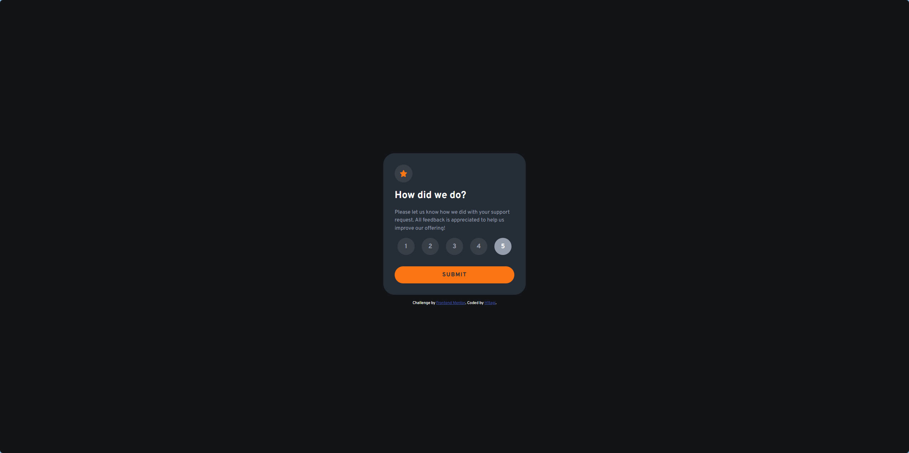

# Frontend Mentor - Interactive rating component solution

This is a solution to the [Interactive rating component challenge on Frontend Mentor](https://www.frontendmentor.io/challenges/interactive-rating-component-koxpeBUmI). Frontend Mentor challenges help you improve your coding skills by building realistic projects.

## Table of contents

- [Overview](#overview)
  - [The challenge](#the-challenge)
  - [Screenshot](#screenshot)
  - [Links](#links)
- [My process](#my-process)
  - [Built with](#built-with)
  - [What I learned](#what-i-learned)
  - [Continued development](#continued-development)
  - [Useful resources](#useful-resources)
  - [AI Collaboration](#ai-collaboration)
- [Author](#author)

## Overview

### The challenge

Users should be able to:

- View the optimal layout for the app depending on their device's screen size
- See hover states for all interactive elements on the page
- Select and submit a number rating
- See the "Thank you" card state after submitting a rating

### Screenshot

### Links

- Solution URL: **To Be Supplemented** 
- Live Site URL: [https://berrypie1.github.io/interactive-rating-component/](https://berrypie1.github.io/interactive-rating-component/)
- Repository: [https://github.com/BerryPie1/interactive-rating-component](https://github.com/BerryPie1/interactive-rating-component) 

## My process

### Built with

- HTML5
- CSS3
- JavaScript
- [Overpass](https://fonts.google.com/specimen/Overpass)

### What I learned

- I have become more proficient in using HTML, CSS and JavaScript to design and control interactions between elements.

**To Be Supplemented** 

### Continued development

- ...

**To Be Supplemented** 

### Useful resources

- [Google Fonts — Overpass](https://fonts.google.com/specimen/Overpass)

**To Be Supplemented** 

### AI Collaboration

- This project uses Cursor as a learning guide, which generates guidance and assists with periodic assessments.

## Author

- Frontend Mentor: [@H1tagi](https://www.frontendmentor.io/profile/BerryPie1)
- GitHub: [@BerryPie1](https://github.com/BerryPie1)